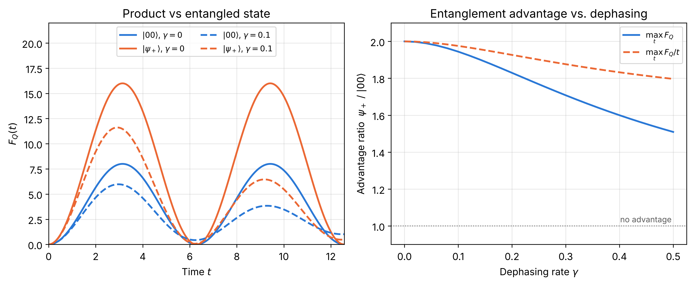

# Entanglement dynamics and quantum metrology in a two-qubit Heisenberg XXZ model

A small, fully reproducible study of how entanglement evolves in a two-qubit Heisenberg **XXZ** model and whether it helps **quantum parameter estimation** (quantum Fisher information, QFI), with and without local dephasing. Everything is implemented with [QuTiP](https://qutip.org), and every number in the texts is regenerated and cross-checked by the code in this repository.

> **Author:** Dhimen Nabil, Master in Mathematical Physics, Faculty of Sciences, Mohammed V University, Rabat (LPHE – Modélisation et Simulation).

## Documents

| File | Content |
| --- | --- |
| [`paper/paper.pdf`](paper/paper.pdf) | Short paper (7 pages): abstract, model, results, discussion. Start here. |
| [`report/main.pdf`](report/main.pdf) | Full technical report (24 pages): all hand derivations, explicit density matrices $\rho$, $\rho^{T_B}$, $\rho_A$, $\rho_B$ for every state, eigenvalue and concurrence proofs. |

## What is studied

The Hamiltonian is $H = J(\sigma_x\sigma_x + \sigma_y\sigma_y + \Delta\,\sigma_z\sigma_z)$ ($\hbar=1$, $J=1$, $\Delta=0.5$). The total $S_z$ is conserved, so the Hilbert space splits into sectors $M=+1,0,-1$. Four pure initial states were chosen to cover this structure:

| Initial state | Role |
| --- | --- |
| $\lvert 00\rangle$ | stationary product state (control) |
| $\lvert 01\rangle$ | product state that becomes maximally entangled, $C(t)=\lvert\sin 4Jt\rvert$ |
| $(\lvert 00\rangle+\lvert 01\rangle)/\sqrt2$ | product state with partial entanglement, $C_{\max}=1/2$ (superposition of two sectors) |
| $\lvert\psi_+\rangle=(\lvert 01\rangle+\lvert 10\rangle)/\sqrt2$ | stationary maximally entangled state (control) |

1. **Entanglement and purity** (closed form): concurrence, negativity and reduced-state purity. $\Delta$ only produces phases.
2. **Commuting generator** $V=S_z$: $F_Q=4t^2\,\mathrm{Var}(V)$. The Bell state has $F_Q=0$: here entanglement and metrological usefulness are unrelated.
3. **Non-commuting generator** $V=S_x$ and **local dephasing** (Lindblad): $\Delta$ enters through the detuning $\omega=2J(1-\Delta)$, the Bell state gives exactly twice the QFI of $\lvert 00\rangle$ without noise, and with dephasing this advantage shrinks but survives at the best interrogation time.

### Main results

* Without noise, for $V=S_x$: $F_Q^{(00)}=8\sin^2(\omega t/2)/\omega^2$ and $F_Q^{(\psi_+)}=2F_Q^{(00)}$.
* No entanglement sudden death under local dephasing: C(ψ+)(t) = exp(−2γt), and C(01)(t) = (4J/Ω) exp(−γt) |sin Ωt| with Ω = √(16J² − γ²).
* Ratio of the maximal QFI of $\lvert\psi_+\rangle$ to that of $\lvert 00\rangle$: **2.00** ($\gamma=0$), **1.94** ($\gamma=0.1$), **1.83** ($\gamma=0.2$), **1.51** ($\gamma=0.5$).
* At long times $\lvert 00\rangle$, $\lvert 01\rangle$ and $\lvert\psi_+\rangle$ reach the same QFI plateau (empirically 2/(ω² + γ²)), so the advantage is a finite-time effect.

<p align="center">
  
</p>

### Scope and limitations

This is a two-qubit case study with standard ingredients (concurrence, QFI, Lindblad dephasing); the contribution is a complete, quantitative and numerically cross-checked characterisation of these four states. Initial states are pure, one noise model is used, and with two qubits no scaling with the number of probes can be extracted. The long-time plateau formula is an empirical fit that I have not derived, and attainability of the Cramér–Rao bound by a specific measurement is not discussed.

## Repository structure

```
xxz/                       QuTiP package
  model.py                 Hamiltonian, S_x / S_z, the four states, dephasing operators
  dynamics.py              time evolution (mesolve, tight tolerances)
  measures.py              concurrence, negativity, purities, closed-form concurrence under dephasing
  metrology.py             QFI (mixed state, Duhamel, closed forms), Cramér–Rao bound
scripts/
  closed_system_figures.py entanglement, purity, QFI, Cramér–Rao bound for V = S_z
  dephasing_figures.py     V = S_x with dephasing: figures and LaTeX tables
  validate.py              all cross-checks (see below)
figures/  tables/          generated figures (PNG and PDF) and LaTeX tables used by the texts
paper/    report/          LaTeX sources and compiled PDFs
```

## Installation and usage

Python 3.10+ is recommended.

```bash
pip install -r requirements.txt

python scripts/validate.py                 # run all numerical checks (a few seconds)
python scripts/closed_system_figures.py figures
python scripts/dephasing_figures.py .      # figures/nc_*.{png,pdf} and tables/nc_*.tex

# optional: rebuild the PDFs (needs a LaTeX installation)
make pdf
```

Minimal example:

```python
import numpy as np
from xxz import model, metrology

t = np.linspace(0, 4 * np.pi, 400)
psi_product = model.initial_states()[0][3]     # |00>
psi_bell    = model.initial_states()[3][3]     # |psi+>

F_product = metrology.qfi_series(psi_product, t, gamma=0.1, generator="x")
F_bell    = metrology.qfi_series(psi_bell,    t, gamma=0.1, generator="x")
print(F_product.max(), F_bell.max())           # 5.97  11.61
```

## Validation

`python scripts/validate.py` checks, with explicit tolerances:

* QuTiP evolution against an independent NumPy/SciPy implementation (exponentiation of the $16\times16$ Liouvillian): $4\times10^{-10}$.
* Analytic $C(t)$, $\mathcal N(t)$, $P_A(t)$, $P_B(t)$ against numerics, the relations $\mathcal N=C/2$ and $P=1-C^2/2$, and the independence of $C(t)$ from $\Delta$.
* $F_Q=4t^2\mathrm{Var}(S_z)$ against a finite-difference QFI.
* For $V=S_x$: finite-difference QFI against the Duhamel formula ($4\times10^{-6}$), Duhamel against the closed forms ($10^{-14}$), and $F^{(\psi_+)}=2F^{(00)}$.
* Mixed-state QFI under dephasing with three independent estimators (eigen-decomposition, superoperator pseudo-inverse, fidelity-based): $10^{-15}$ and $2.4\times10^{-3}$.
* Closed-form concurrence under dephasing against Wootters' formula ($7\times10^{-10}$) and the long-time plateau against $2/(\omega^2+\gamma^2)$.

## Citation

See [`CITATION.cff`](CITATION.cff). Released under the [MIT License](LICENSE).
